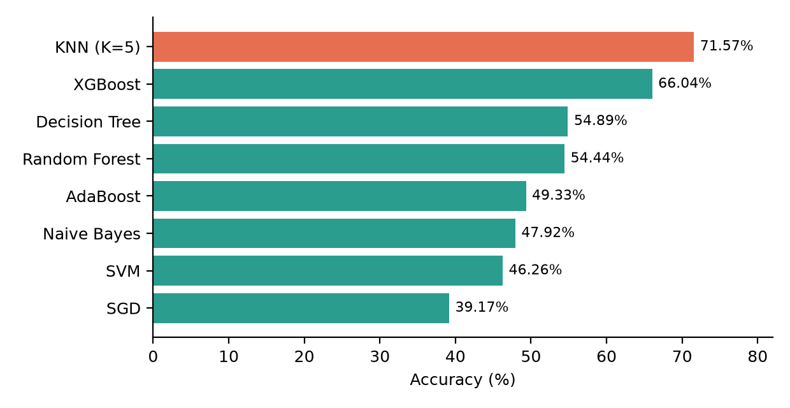
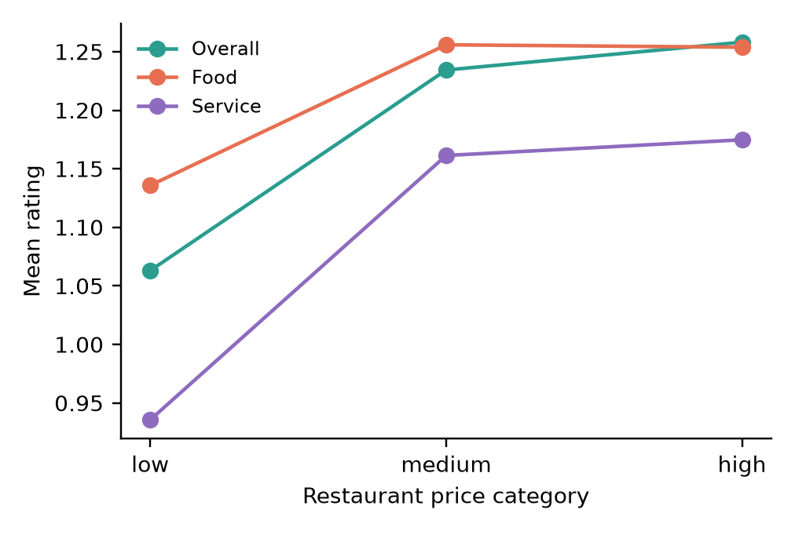
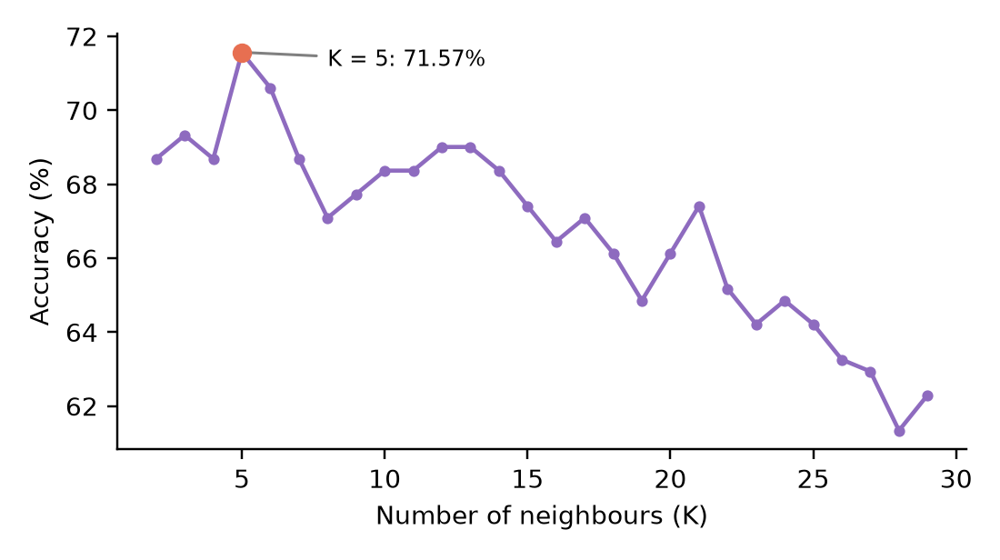
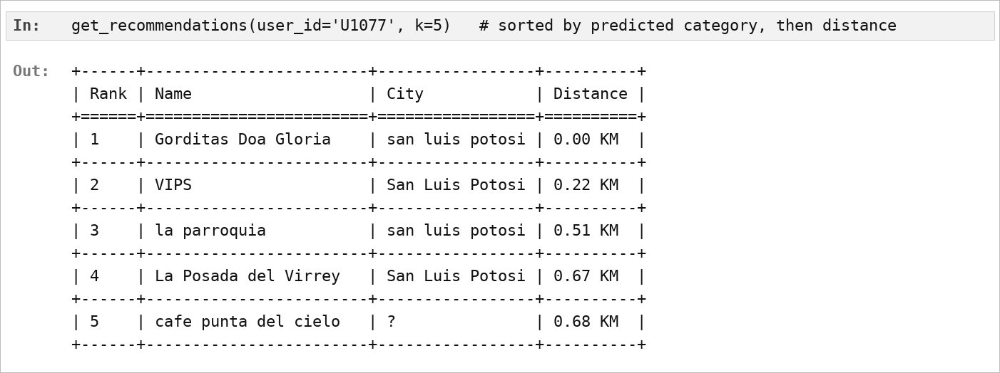

# DineWise: Restaurant Recommender

A content-based restaurant recommendation system that matches a consumer's profile with restaurant attributes using **K-Nearest Neighbours (KNN)**, then ranks the suggestions by **distance** (Haversine formula) so results are both relevant and nearby.



## Highlights

- Cleans and merges nine CSV files (restaurants, consumers, ratings) into one modelling table of **1,042 records and 15 features**.
- Exploratory analysis of ratings against price, parking, alcohol, dress code and more.
- Compares **KNN, Random Forest, Decision Tree, SVM, XGBoost** (plus AdaBoost, Naive Bayes, SGD) with hyper-parameter tuning.
- Generates a **top-N list per user**, sorted by predicted rating category and then by distance in km.

## Dataset

[Restaurant & Consumer Data with Consumer Ratings](https://www.kaggle.com/datasets/uciml/restaurant-data-with-consumer-ratings) (UCI Machine Learning Repository, CC BY 4.0). Copies of the files are in [`RCdata/`](RCdata/).

| Item | Count |
|---|---|
| Ratings | 1,161 |
| Consumers rating | 138 |
| Restaurants rated | 130 |
| Unique restaurant IDs | 938 |
| Rating matrix sparsity | 93.5% |

Ratings (overall, food, service) take the values 0, 1 or 2.

## Approach

1. **Preprocessing:** replace `?` with NaN, standardise categories, drop rows with no restaurant details, one-hot encode cuisine and parking, label-encode the other categorical features.
2. **EDA:** rating distributions, correlations (overall vs. food 0.71, vs. service 0.69) and mean rating by restaurant attributes.
3. **Modelling:** 70/30 train/test split repeated over ten random seeds; KNN with Euclidean distance and K from 2 to 29.
4. **Recommendation:** the user's profile is combined with each restaurant's attributes, KNN predicts a rating category (0 to 6), and results are sorted by category then Haversine distance.

<p>
 
</p>

## Results

| Measure | Value |
|---|---|
| Selected model | KNN, K = 5, Euclidean distance |
| Accuracy, good vs. not-good rating (best split) | 71.57% |
| Accuracy, mean of ten splits (same grouping) | about 65.8% (std 1.9) |
| Accuracy on the three-class rating (0, 1, 2) | about 54.5% (majority baseline 43.7%) |

On the three-class rating, KNN, Decision Tree, XGBoost and Random Forest perform almost identically; SVM with a linear kernel is weakest. Ratings come from a small, sparse dataset, so treat the figures as indicative.

Example output for one user:



## Getting started

```bash
git clone https://github.com/AnishaGupta-tech/DineWise-Restaurant-Recommender.git
cd DineWise-Restaurant-Recommender
python -m venv .venv && source .venv/bin/activate
pip install -r requirements.txt
jupyter notebook
```

Open the notebooks in this order:

1. [`Project_EDA.ipynb`](Project_EDA.ipynb): data exploration, cleaning and merging.
2. [`Models.ipynb`](Models.ipynb): model comparison, tuning and the recommendation + distance ranking.

The notebooks were written in Google Colab. If you run them locally, change the file paths that point to Google Drive to `RCdata/`.

## Project structure

```
RCdata/            dataset CSV files and dataset README
Project_EDA.ipynb  exploration, cleaning, merging
Models.ipynb       models, evaluation, recommendations
docs/images/       figures used in this README
requirements.txt   Python dependencies
LICENSE            MIT (code and documentation)
NOTICE             dataset licence and attribution
```

## Limitations and future work

- Small dataset (3 to 18 ratings per user), so accuracy gains over the baseline are modest.
- Label encoding gives nominal features an artificial order and age is unscaled; scaling and one-hot encoding should help KNN.
- Only four restaurant attributes vary in the model; cuisine and parking can be added.
- Next steps: cross-validation, ranking metrics (Precision@K, NDCG), a hybrid model with collaborative filtering, and a web app using live location.

## Author

Built by [Anisha Gupta](https://github.com/AnishaGupta-tech).

## License

Code and documentation: [MIT](LICENSE). Dataset: CC BY 4.0, courtesy of the UCI Machine Learning Repository; see [`NOTICE`](NOTICE) and [`RCdata/README`](RCdata/README).
